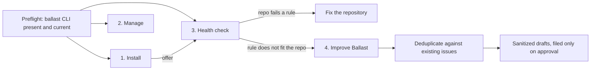

# `ballast` user skill

The `ballast` user skill lets Claude Code and Codex install, manage, and health-check Ballast in any repository you open, including repositories that do not use Ballast yet. Unlike the other skills in this directory, it is installed once per user, not per repository, and it ships inside the `ballast` CLI.

## Install

```bash
ballast user-skill install
```

This writes:

| Agent | Path | Override |
| --- | --- | --- |
| Claude Code | `~/.claude/skills/ballast/SKILL.md` | `$CLAUDE_CONFIG_DIR/skills/ballast/SKILL.md` |
| Codex | `~/.codex/skills/ballast/SKILL.md` | `$CODEX_HOME/skills/ballast/SKILL.md` |

Restart the agent to load it. Install for one agent with `--target claude` or `--target codex`.

## Use

Ask in plain language, or invoke `/ballast` in Claude Code:

```text
Install ballast in this repo.
Do a ballast health check on this repo.
Is this repo following its ballast rules? Suggest fixes to ballast to make it better.
Upgrade ballast and add the cursor target.
```

The skill routes each request to one of four workflows:



1. **Install** detects targets, task system, deployment model, and code reviewer from the repository, then runs `ballast install ... --yes` and verifies with `ballast doctor`.
2. **Manage** covers `doctor`, `upgrade --patch`, `--refresh-config`, and adding or removing targets, agents, skills, and languages, and checks `.rulesrc.json` was not silently rewritten.
3. **Health check** checks the Ballast installation itself (version drift, hand-edited generated files, `ballast-audit` when installed, without its user-skill install step), then checks the repository against the requirements in each installed rule. Every requirement is marked **pass**, **fail**, **rule mismatch**, or **n/a**.
4. **Improve Ballast** turns rule mismatches and CLI errors into deduplicated, sanitized issue drafts for `everydaydevopsio/ballast`. Nothing is filed without your approval, and drafts never name private repositories or include proprietary code.

## Manage

```bash
ballast user-skill status    # installed version per agent, flags outdated copies
ballast user-skill install   # refresh after `ballast update`
ballast user-skill remove    # remove the Ballast-managed copies
```

`ballast doctor` also prints a `User skill (ballast):` section with the same per-agent status, followed by the exact command to run:

```
User skill (ballast):
- claude: installed 5.22.3 (outdated, running 5.23.0) (~/.claude/skills/ballast/SKILL.md)
- codex: not installed (~/.codex/skills/ballast/SKILL.md)
Install the ballast user skill: ballast user-skill install --target codex
Update the ballast user skill: ballast user-skill install --target claude
```

The section is informational: `doctor --fix` does not write to your agent config. The repository `ballast-audit` skill runs those commands for you as part of an audit.

The installed file carries a `<!-- ballast-user-skill version=... -->` marker. `install` overwrites only files with that marker; if a different skill named `ballast` already exists, it refuses unless you pass `--force`. `remove` deletes only the marked `SKILL.md`, keeps any other files in the skill directory, and removes the directory only when it is left empty. A copy newer than the running CLI is reported as `newer than running` and never gets an update hint, and `install` refuses to replace it unless you pass `--force`, so an older wrapper cannot downgrade it by accident. Writes go to a temporary file that is renamed into place, so a failed install leaves the previous skill intact.

## Relationship to repository skills

| | `ballast` user skill | `ballast-audit`, `ballast-project-maintenance` |
| --- | --- | --- |
| Installed by | `ballast user-skill install` | `ballast install --skill ...` |
| Scope | every repository for the user | one repository, committed |
| Works before Ballast is installed | yes | no |
| Covers | install, manage, rule compliance, upstream feedback | audit and repair of an existing installation |

The user skill delegates to `ballast-audit` during a health check when the repository has it. A health check is report-only, so it skips the audit's user-skill install step and lists any `ballast user-skill install` command doctor prints as a remediation instead.

## Source

The skill lives at [`cli/ballast/userskills/ballast/SKILL.md`](../../cli/ballast/userskills/ballast/SKILL.md) and is embedded into the wrapper binary at build time. It is not part of the per-repository skill registries, and no language backend installs it.
